# HA Separate Garbage Collection Card

> A Lovelace custom card for Home Assistant that shows your waste collection schedule straight from a calendar. You do not need Python or a custom integration.

[![HACS Custom][hacs-badge]][hacs-url]
[![License: GNU3.0][license-badge]][license-url]


This is a fork of [Raccolta differenziata](https://hassiohelp.eu/2019/03/17/raccolta-differenziata/) by Enrico & Caio on [HassioHelp](https://hassiohelp.eu). Only a redesigned version of the background and the trash bin is left from the original.

<a href="https://paypal.me/redfoxydarrest" target="_blank"></a>

---

## 🇬🇧 English · [🇮🇹 Italiano](#-italiano)

---

## What it does

[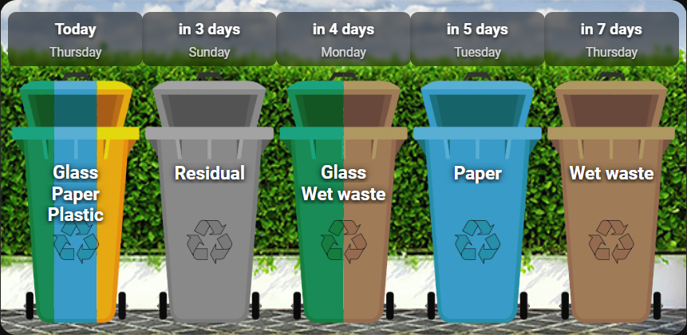](/examples/5-days.yaml)

The card reads events from any Home Assistant calendar (Local Calendar, Google Calendar, CalDAV…) and shows the next collection days as coloured bins.

- One parameter sets the layout: `days: 1` gives a single-day view, `days: 5` gives five columns, and any other number works too.
- It has no dependencies. The browser reads the Home Assistant calendar REST API directly, with no custom integration, no Python and no YAML sensors.
- Bins are coloured from the event. Write `color: #4CAF50` in the event description and the card tints the bin with a CSS filter calibrated on the base SVG colour (`#f68b22`).
- You can replace the bin with your own image per waste type with `icon: filename.png`.
- Empty days are skipped by default (`skip_empty: true`), so the card shows the next N days _that have a collection_.
- The waste type name sits on the bin, just below the lid. Names with spaces wrap to two lines; a single long word is shortened (for example `Indiffer.`).
- When a day has two or more collections, the card draws one bin split into `N` equal slices, each exactly `1/N` of the bin. Slices go left to right (`vertical`) or top to bottom (`horizontal`), and the names are stacked on the bin in alphabetical order, so the layout does not change between refreshes. Use `merge_same_day` and `split_direction` to control this.
- `show_before` sets a daily cut-off time. Before it the card shows today's collection, after it tomorrow's, so in the evening you see what to put out for the next morning.
- 12 languages are built in (`en`, `it`, `fr`, `de`, `es`, `pt`, `nl`, `hu`, `ru`, `hi`, `zh`, `ja`). They cover day labels, weekday names, the default title and the "no collection" text. The card follows the Home Assistant language; set `language: it` (or another code) to force one.
- If your language is missing, you can override every text in the card YAML: `day_labels`, `short_days`, `full_days`, `title`, `empty_text`.

---

## Requirements

| Requirement | Notes |
|---|---|
| Home Assistant ≥ 2023.4 | Needs the calendar REST endpoint |
| A calendar integration | The built-in Local Calendar works well |
| `trashbin.svg` | Base bin icon, in the folder below |
| `background.png` | Card background image, in the same folder |

Default asset folder (manual install): `/config/www/redfoxy/ha-separate-garbage-collection/`

> The card loads `trashbin.svg`, `background.png` and custom icons with a relative name from the folder that holds the JS file. Any install path works: HACS (`/hacsfiles/…`), the Home Assistant Marketplace, resources from older HACS versions (`/local/community/…`) and a manual install in any folder. Keep the three files together.

---

## Installation

### Via HACS (recommended)

1. Open HACS → **Frontend**
2. Click ⋮ → **Custom repositories**
3. Add `https://github.com/RedFoxy/HA-Separate-Garbage-Collection` with category **Dashboard**
4. Click **Download**
5. Reload your browser

### Manual

1. Copy `ha-separate-garbage-collection-card.js`, `trashbin.svg` and `background.png` to `/config/www/redfoxy/ha-separate-garbage-collection/`
2. In Home Assistant go to **Settings → Dashboards → ⋮ → Resources → Add resource**

[](https://my.home-assistant.io/redirect/lovelace_dashboards/)

   - URL: `/local/redfoxy/ha-separate-garbage-collection/ha-separate-garbage-collection-card.js`
   - Type: **JavaScript module**
3. Hard-reload the browser (`Ctrl + Shift + R`)

---

## Setting up the calendar

### 1. Create a Local Calendar

Go to **Settings → Integrations → Add integration → Local Calendar**.  
Give it a name (for example `Waste`). Home Assistant creates the entity `calendar.waste`.

### 2. Add recurring events

Open the **Calendar** view in the sidebar and add one all-day recurring event for each waste type.

| Field | What to enter |
|---|---|
| Title | Waste type name, shown on the card (for example `Wet waste`, `Paper`, `Glass`) |
| All day | ✅ Yes |
| Recurrence | Weekly, every two weeks or monthly, as your schedule needs |
| Description | Settings for the card (format below) |

Event description format, one setting per line:

```
color: #4CAF50
icon: wet.png
filter: hue-rotate(92deg) saturate(42%) brightness(1.07)
```

| Key | Required | Description |
|---|---|---|
| `color` | ✅ | HEX colour used to tint `trashbin.svg` |
| `icon` | ❌ | Custom image: a file name in the card folder, or an absolute path starting with `/` |
| `filter` | ❌ | Your own CSS filter, used instead of the one computed from `color` |

> Without `icon`, the card shows `trashbin.svg` tinted with a CSS filter computed from `color`. The filter is calibrated on the base SVG colour (`#f68b22`).

> ⚠️ `icon` is ignored on days with more than one collection. With `merge_same_day: true` (the default) those days get a single `trashbin.svg` split into N coloured slices, and the colour split only works on the plain base SVG. Your custom icon still shows on days where that waste type is the only collection. Set `merge_same_day: false` to keep custom icons on every day.

---

## Card options

### Card type

```yaml
type: custom:ha-separate-garbage-collection-card
```

### All options

| Option | Type | Default | Description |
|---|---|---|---|
| `calendar` | string | required | Calendar entity ID (for example `calendar.waste`) |
| `days` | number | `5` | Number of days (columns). `1` gives the single-day layout with larger icons |
| `background` | string | `…/background.png` | Background image URL |
| `show_before` | string | `"09:00"` | Cut-off time `HH:MM`. Before it the card shows today, from that time on it shows tomorrow |
| `show_title` | bool | `false` | Show the card title bar |
| `title` | string | `"Waste collection"` (localised) | Card title, shown only with `show_title: true` |
| `show_labels` | bool | `true` | Write the waste type name on the bin |
| `show_day_labels` | bool | `true` | Show the day label (Today, Tomorrow, in N days…) |
| `show_weekday` | bool | `true` | Show the weekday name under the day label |
| `weekday_format` | string | `"short"` | Weekday name format: `short` (Mon, Tue…) or `full` (Monday, Tuesday…) |
| `language` | string | `null` (auto) | Force the language. With `null` the card follows `hass.language`. Available: `en`, `it`, `fr`, `de`, `es`, `pt`, `nl`, `hu`, `ru`, `hi`, `zh`, `ja` |
| `day_labels` | list | auto | Your own day labels (default: Today, Tomorrow, in N days, in the active language) |
| `short_days` | list | auto | Your own short weekday names, exactly 7 entries from Sunday to Saturday (default: active language) |
| `full_days` | list | auto | Your own full weekday names, exactly 7 entries from Sunday to Saturday (default: active language; used with `weekday_format: full`) |
| `skip_empty` | bool | `true` | Skip days without a collection |
| `refresh_interval` | number | `300` | Seconds between calendar refreshes (minimum 10) |
| `icon_size` | number | auto | Bin size in px (auto: 64 for `days: 1`, 52 otherwise) |
| `column_width` | number | auto | Fixed column width in px. Without it the columns share the space equally |
| `empty_text` | string | `"No collection"` (localised) | Text in the single-day view when there is no collection |
| `empty_symbol` | string | `"·"` | Symbol in empty columns (multi-day view) |
| `merge_same_day` | bool | `true` | Draw one bin with N coloured slices when a day has two or more events, with the names stacked on it. The per-event `icon:` is ignored on those days |
| `split_direction` | string | `"vertical"` | How the merged bin is split: `vertical` (left/right) or `horizontal` (top/bottom) |

---

## Examples

### Minimal: 5-day view

```yaml
type: custom:ha-separate-garbage-collection-card
calendar: calendar.waste
```

[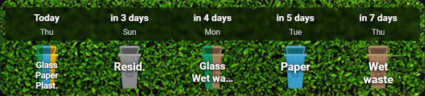](/examples/minimal-5-days-view.yaml)

### Single day with large icons

```yaml
type: custom:ha-separate-garbage-collection-card
calendar: calendar.waste
days: 1
icon_size: 80
```

[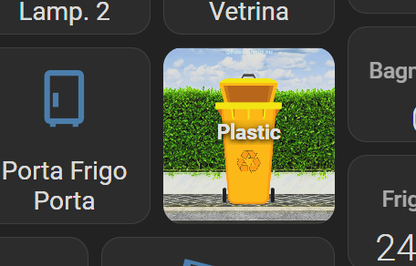](/examples/single-card.yaml)

### 3-day view

```yaml
type: custom:ha-separate-garbage-collection-card
calendar: calendar.waste
days: 3
```

[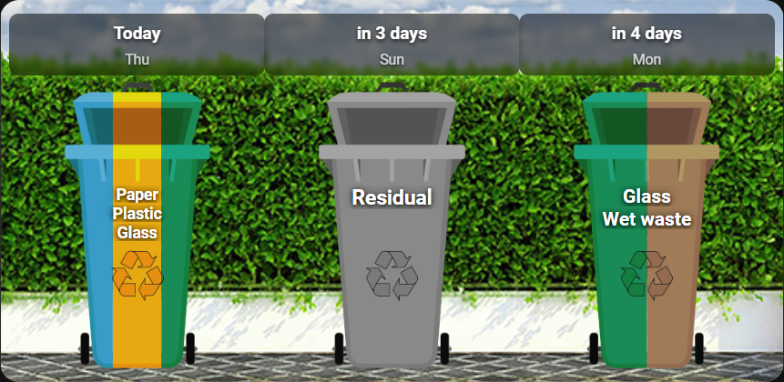](/examples/3-days-view.yaml)

### With title, no weekday row

```yaml
type: custom:ha-separate-garbage-collection-card
calendar: calendar.waste
days: 5
show_title: true
title: "This week's collections"
show_weekday: false
```

[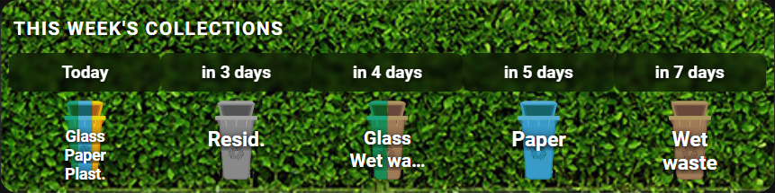](/examples/with-title-no-weekday-row.yaml)

### 7 days, slow refresh, larger icons

```yaml
type: custom:ha-separate-garbage-collection-card
calendar: calendar.waste
days: 7
icon_size: 60
refresh_interval: 3600
show_weekday: true
```

[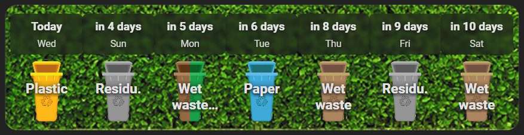](/examples/7-days-slow-refresh-larger-icons.yaml)

### Fixed column width

```yaml
type: custom:ha-separate-garbage-collection-card
calendar: calendar.waste
days: 4
column_width: 110
```

[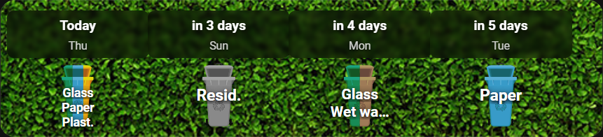](/examples/fixed-column-width.yaml)

### Several collections on one day, horizontal split

```yaml
type: custom:ha-separate-garbage-collection-card
calendar: calendar.waste
days: 5
merge_same_day: true
split_direction: horizontal
icon_size: 180
```

[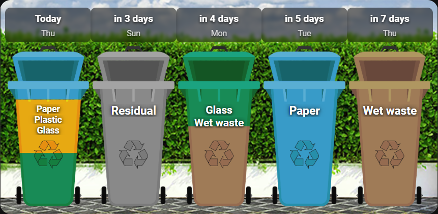](/examples/horizontal-split.yaml)

When a day has more than one collection (for example Paper and Glass on the same Monday), the card draws one bin cut into horizontal stripes, one per waste type, with the names stacked on the bin.

> ⚠️ Custom icons are not used in this mode. The split needs the plain `trashbin.svg` to tint each slice on its own, so the per-event `icon:` is ignored on merged days. Your custom icon still shows on days where that waste type is the only collection, and `merge_same_day: false` turns the merge off everywhere.

With `merge_same_day: false` the card goes back to the original layout: one bin per event, side by side.

### Italian translation

```yaml
type: custom:ha-separate-garbage-collection-card
calendar: calendar.waste
days: 5
empty_text: Nessuna raccolta
empty_symbol: —
language: it
```

[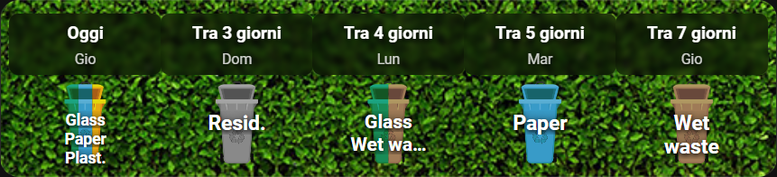](/examples/italian-translation.yaml)

### French translation

```yaml
type: custom:ha-separate-garbage-collection-card
calendar: calendar.waste
days: 5
empty_text: Pas de collecte
language: fr
```

[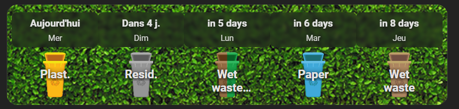](/examples/french-translation.yaml)

### Calendar event examples

Wet waste, every Monday, Thursday and Saturday:
```
Title:        Wet waste
All day:      ✅
Recurrence:   Weekly on Mon, Thu, Sat
Description:
  color: #4CAF50
```

Paper and cardboard, every Tuesday:
```
Title:        Paper
All day:      ✅
Recurrence:   Weekly on Tue
Description:
  color: #2196F3
```

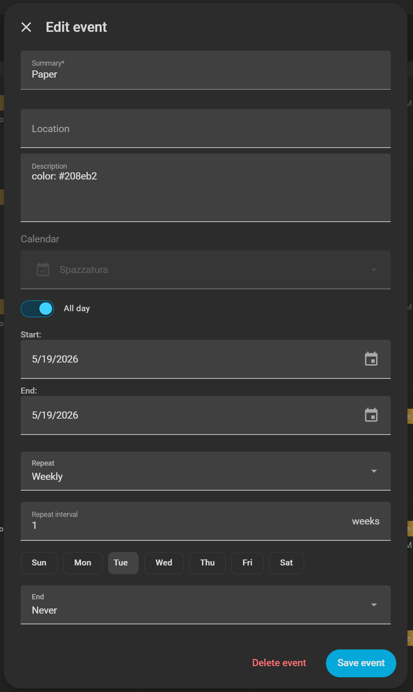

Plastic, every Wednesday:
```
Title:        Plastic
All day:      ✅
Recurrence:   Weekly on Wed
Description:
  color: #FF9800
```

Glass, every other Monday:
```
Title:        Glass
All day:      ✅
Recurrence:   Every 2 weeks on Mon
Description:
  color: #8BC34A
```

Residual waste, every Friday:
```
Title:        Residual
All day:      ✅
Recurrence:   Weekly on Fri
Description:
  color: #9E9E9E
```

Garden waste, every other Saturday, with a custom icon:
```
Title:        Garden
All day:      ✅
Recurrence:   Every 2 weeks on Sat
Description:
  color: #795548
  icon: garden.png
```

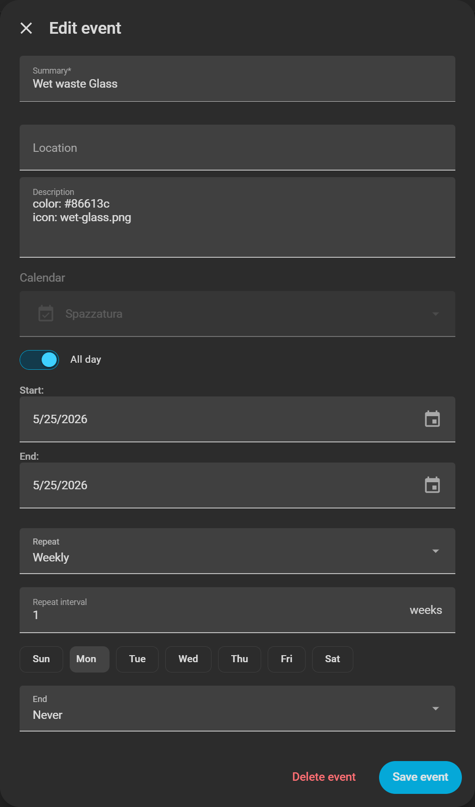

---

## How `show_before` works

Before the `show_before` time the card counts today as day 0. From that time on, tomorrow is day 0, so the card always shows the next collection to put out.

| Time | `show_before: "09:00"` | Day 0 |
|---|---|---|
| 07:30 | 09:00 | Today (the collection has not happened yet) |
| 09:01 | 09:00 | Tomorrow (today's pickup is done; get ready tonight) |
| 22:00 | 09:00 | Tomorrow |

---

## File structure

```
/config/www/redfoxy/ha-separate-garbage-collection/
├── ha-separate-garbage-collection-card.js   ← Lovelace card (this file)
├── trashbin.svg                 ← base bin icon  (base colour: #f68b22)
├── background.png               ← card background image
└── *.png / *.svg                ← optional custom icons per waste type
```

---

## Colour system

The CSS filter is calibrated on the colours of the base SVG:

| Part | Colour |
|---|---|
| Body | `#f68b22` |
| Dark detail | `#f07525` |
| Shadow | `#c15a28` |
| Highlight | `#fcb315` |

For example, `color: #2196F3` in the event description gives  
`hue-rotate(177deg) saturate(98%) brightness(1.18)`, with no manual tuning.

To set the filter yourself, write `filter:` in the description.

---

# 🇮🇹 Italiano

> Card Lovelace per Home Assistant che mostra il calendario della raccolta differenziata. Non servono Python né integrazioni custom.

---

## Cosa fa

[](/examples/5-days.yaml)

La card legge gli eventi da qualsiasi calendario di Home Assistant (Local Calendar, Google Calendar, CalDAV…) e mostra i prossimi giorni di raccolta come cestini colorati.

- Un solo parametro decide il layout: `days: 1` dà la vista giornaliera, `days: 5` cinque colonne, e va bene qualsiasi altro numero.
- Non ha dipendenze. Il browser legge direttamente la REST API del calendario di Home Assistant: niente integrazioni custom, niente Python, niente sensori YAML.
- Il colore arriva dall'evento. Scrivi `color: #4CAF50` nella descrizione e la card tinge il cestino con un filtro CSS calibrato sul colore base del SVG (`#f68b22`).
- Con `icon: nomefile.png` puoi usare un'immagine tua per ogni tipo di rifiuto.
- I giorni senza raccolta vengono saltati di default (`skip_empty: true`), quindi la card mostra i prossimi N giorni _in cui c'è qualcosa da portare fuori_.
- Il nome del rifiuto è scritto sul cestino, appena sotto il coperchio. I nomi con spazi vanno a capo su due righe; una parola singola troppo lunga viene abbreviata (per esempio `Indiffer.`).
- Quando in un giorno ci sono due o più raccolte, la card disegna un solo cestino diviso in `N` fette uguali, ognuna esattamente `1/N` del cestino. Le fette vanno da sinistra a destra (`vertical`) o dall'alto in basso (`horizontal`) e i nomi sono impilati sul cestino in ordine alfabetico, così il layout non cambia tra un aggiornamento e l'altro. Si regola con `merge_same_day` e `split_direction`.
- `show_before` fissa un orario di cambio giornaliero. Prima di quell'ora la card mostra la raccolta di oggi, dopo quella di domani: la sera vedi cosa preparare per la mattina dopo.
- Le lingue integrate sono 12 (`en`, `it`, `fr`, `de`, `es`, `pt`, `nl`, `hu`, `ru`, `hi`, `zh`, `ja`) e coprono le etichette dei giorni, i nomi dei giorni della settimana, il titolo predefinito e il testo "nessuna raccolta". La card segue la lingua di Home Assistant; con `language: it` (o un altro codice) la forzi.
- Se la tua lingua manca, puoi sostituire ogni testo nello YAML della card: `day_labels`, `short_days`, `full_days`, `title`, `empty_text`.

---

## Requisiti

| Requisito | Note |
|---|---|
| Home Assistant ≥ 2023.4 | Serve l'endpoint REST del calendario |
| Un'integrazione calendario | Il Local Calendar integrato va benissimo |
| `trashbin.svg` | Icona base del cestino, nella cartella indicata sotto |
| `background.png` | Sfondo della card, nella stessa cartella |

Cartella asset predefinita (installazione manuale): `/config/www/redfoxy/ha-separate-garbage-collection/`

> La card carica `trashbin.svg`, `background.png` e le icone personalizzate indicate con un nome relativo dalla cartella in cui si trova il file JS. Funziona con qualsiasi percorso di installazione: HACS (`/hacsfiles/…`), il Marketplace di Home Assistant, le risorse delle vecchie versioni di HACS (`/local/community/…`) e l'installazione manuale in qualsiasi cartella. Tieni i tre file insieme.

---

## Installazione

### Tramite HACS (consigliato)

1. Apri HACS → **Frontend**
2. Clicca ⋮ → **Repository personalizzati**
3. Aggiungi `https://github.com/RedFoxy/HA-Separate-Garbage-Collection` con categoria **Dashboard**
4. Clicca **Scarica**
5. Ricarica il browser

### Manuale

1. Copia `ha-separate-garbage-collection-card.js`, `trashbin.svg` e `background.png` in `/config/www/redfoxy/ha-separate-garbage-collection/`
2. In Home Assistant vai su **Impostazioni → Dashboard → ⋮ → Risorse → Aggiungi risorsa**
   - URL: `/local/redfoxy/ha-separate-garbage-collection/ha-separate-garbage-collection-card.js`
   - Tipo: **Modulo JavaScript**

[](https://my.home-assistant.io/redirect/lovelace_dashboards/)

3. Forza il ricaricamento del browser (`Ctrl + Shift + R`)

---

## Configurare il calendario

### 1. Crea un calendario locale

Vai su **Impostazioni → Integrazioni → Aggiungi integrazione → Local Calendar**.  
Dagli un nome (per esempio `Spazzatura`). Home Assistant crea l'entità `calendar.spazzatura`.

### 2. Aggiungi gli eventi ricorrenti

Apri la vista **Calendario** nella barra laterale e aggiungi un evento ricorrente di tutto il giorno per ogni tipo di rifiuto.

| Campo | Cosa inserire |
|---|---|
| Titolo | Nome del tipo di rifiuto, mostrato sulla card (per esempio `Umido`, `Carta`, `Vetro`) |
| Tutto il giorno | ✅ Sì |
| Ricorrenza | Settimanale, ogni due settimane o mensile, secondo il calendario del tuo Comune |
| Descrizione | Impostazioni per la card (formato sotto) |

Formato della descrizione, un'impostazione per riga:

```
color: #4CAF50
icon: umido.png
filter: hue-rotate(92deg) saturate(42%) brightness(1.07)
```

| Chiave | Obbligatoria | Descrizione |
|---|---|---|
| `color` | ✅ | Colore HEX con cui tingere `trashbin.svg` |
| `icon` | ❌ | Immagine personalizzata: un nome di file nella cartella della card, oppure un percorso assoluto che inizia con `/` |
| `filter` | ❌ | Un filtro CSS tuo, usato al posto di quello calcolato da `color` |

> Senza `icon`, la card mostra `trashbin.svg` tinto con un filtro CSS calcolato da `color`. Il filtro è calibrato sul colore base del SVG (`#f68b22`).

> ⚠️ `icon` viene ignorato nei giorni con più di una raccolta. Con `merge_same_day: true` (il default) quei giorni hanno un solo `trashbin.svg` diviso in N fette colorate, e la divisione per colori funziona solo sul SVG base. L'icona personalizzata compare comunque nei giorni in cui quel tipo di rifiuto è l'unica raccolta. Con `merge_same_day: false` tieni le icone personalizzate in tutti i giorni.

---

## Opzioni della card

### Tipo card

```yaml
type: custom:ha-separate-garbage-collection-card
```

### Tutte le opzioni

| Opzione | Tipo | Default | Descrizione |
|---|---|---|---|
| `calendar` | stringa | obbligatoria | Entity ID del calendario (per esempio `calendar.waste`) |
| `days` | numero | `5` | Numero di giorni (colonne). `1` dà la vista giornaliera con icone più grandi |
| `background` | stringa | `…/background.png` | URL dell'immagine di sfondo |
| `show_before` | stringa | `"09:00"` | Orario di cambio `HH:MM`. Prima di quell'ora la card mostra oggi, da quell'ora in poi domani |
| `show_title` | bool | `false` | Mostra la barra del titolo |
| `title` | stringa | `"Waste collection"` (tradotto) | Titolo della card, visibile solo con `show_title: true` |
| `show_labels` | bool | `true` | Scrive il nome del rifiuto sul cestino |
| `show_day_labels` | bool | `true` | Mostra l'etichetta del giorno (Oggi, Domani, Tra N giorni…) |
| `show_weekday` | bool | `true` | Mostra il nome del giorno della settimana sotto l'etichetta |
| `weekday_format` | stringa | `"short"` | Formato del giorno della settimana: `short` (Lun, Mar…) o `full` (Lunedì, Martedì…) |
| `language` | stringa | `null` (auto) | Forza la lingua. Con `null` la card segue `hass.language`. Disponibili: `en`, `it`, `fr`, `de`, `es`, `pt`, `nl`, `hu`, `ru`, `hi`, `zh`, `ja` |
| `day_labels` | lista | auto | Etichette dei giorni scelte da te (default: Oggi, Domani, Tra N giorni, nella lingua attiva) |
| `short_days` | lista | auto | Nomi brevi dei giorni scelti da te, esattamente 7 voci da domenica a sabato (default: lingua attiva) |
| `full_days` | lista | auto | Nomi completi dei giorni scelti da te, esattamente 7 voci da domenica a sabato (default: lingua attiva; usati con `weekday_format: full`) |
| `skip_empty` | bool | `true` | Salta i giorni senza raccolta |
| `refresh_interval` | numero | `300` | Secondi tra un aggiornamento del calendario e il successivo (minimo 10) |
| `icon_size` | numero | auto | Dimensione del cestino in px (auto: 64 con `days: 1`, 52 negli altri casi) |
| `column_width` | numero | auto | Larghezza fissa delle colonne in px. Senza questa opzione le colonne si dividono lo spazio in parti uguali |
| `empty_text` | stringa | `"No collection"` (tradotto) | Testo della vista giornaliera quando non c'è raccolta |
| `empty_symbol` | stringa | `"·"` | Simbolo nelle colonne vuote (vista a più giorni) |
| `merge_same_day` | bool | `true` | Quando un giorno ha due o più eventi, disegna un solo cestino con N fette colorate e i nomi impilati sopra. In quei giorni l'opzione `icon:` dei singoli eventi viene ignorata |
| `split_direction` | stringa | `"vertical"` | Come viene diviso il cestino unico: `vertical` (sinistra/destra) o `horizontal` (alto/basso) |

---

## Esempi

### Minimale: 5 giorni

```yaml
type: custom:ha-separate-garbage-collection-card
calendar: calendar.waste
```

[](/examples/minimal-5-days-view.yaml)

### Vista giornaliera con icone grandi

```yaml
type: custom:ha-separate-garbage-collection-card
calendar: calendar.waste
days: 1
icon_size: 80
```

[](/examples/single-card.yaml)

### Vista 3 giorni

```yaml
type: custom:ha-separate-garbage-collection-card
calendar: calendar.waste
days: 3
```

[](/examples/3-days-view.yaml)

### Con titolo, senza riga dei giorni della settimana

```yaml
type: custom:ha-separate-garbage-collection-card
calendar: calendar.waste
days: 5
show_title: true
title: "Raccolta questa settimana"
show_weekday: false
```

[](/examples/with-title-no-weekday-row.yaml)

### Traduzione italiana completa

```yaml
type: custom:ha-separate-garbage-collection-card
calendar: calendar.waste
days: 5
empty_text: Nessuna raccolta
empty_symbol: —
language: it
```

[](/examples/italian-translation.yaml)

### 7 giorni, aggiornamento lento, icone più grandi

```yaml
type: custom:ha-separate-garbage-collection-card
calendar: calendar.waste
days: 7
icon_size: 60
refresh_interval: 3600
show_weekday: true
```

[](/examples/7-days-slow-refresh-larger-icons.yaml)

### Larghezza fissa delle colonne

```yaml
type: custom:ha-separate-garbage-collection-card
calendar: calendar.waste
days: 4
column_width: 110
```

[](/examples/fixed-column-width.yaml)

### Più raccolte nello stesso giorno, divisione orizzontale

```yaml
type: custom:ha-separate-garbage-collection-card
calendar: calendar.waste
days: 5
merge_same_day: true
split_direction: horizontal
icon_size: 180
```

[](/examples/horizontal-split.yaml)

Quando un giorno ha più di una raccolta (per esempio Carta e Vetro lo stesso lunedì), la card disegna un solo cestino diviso in strisce orizzontali, una per tipo di rifiuto, con i nomi impilati sopra.

> ⚠️ In questa modalità le icone personalizzate non vengono usate. Per colorare ogni fetta da sola serve il `trashbin.svg` base, quindi nei giorni uniti il campo `icon:` degli eventi viene ignorato. L'icona personalizzata compare comunque nei giorni in cui quel tipo di rifiuto è l'unica raccolta, e con `merge_same_day: false` disattivi l'unione ovunque.

Con `merge_same_day: false` la card torna al layout originale: un cestino per evento, uno accanto all'altro.

### Esempi di eventi nel calendario

Umido, ogni lunedì, giovedì e sabato:
```
Titolo:       Umido
Tutto il giorno: ✅
Ricorrenza:   Settimanale: Lun, Gio, Sab
Descrizione:
  color: #4CAF50
```

Carta e cartone, ogni martedì:
```
Titolo:       Carta e Cartone
Tutto il giorno: ✅
Ricorrenza:   Settimanale: Mar
Descrizione:
  color: #2196F3
```


Plastica, ogni mercoledì:
```
Titolo:       Plastica
Tutto il giorno: ✅
Ricorrenza:   Settimanale: Mer
Descrizione:
  color: #FF9800
```

Vetro, un lunedì sì e uno no:
```
Titolo:       Vetro
Tutto il giorno: ✅
Ricorrenza:   Ogni 2 settimane: Lun
Descrizione:
  color: #8BC34A
```

Indifferenziata, ogni venerdì:
```
Titolo:       Indifferenziata
Tutto il giorno: ✅
Ricorrenza:   Settimanale: Ven
Descrizione:
  color: #9E9E9E
```

Sterpaglie, un sabato sì e uno no, con icona personalizzata:
```
Titolo:       Sterpaglie
Tutto il giorno: ✅
Ricorrenza:   Ogni 2 settimane: Sab
Descrizione:
  color: #795548
  icon: sterpaglie.png
```


---

## Come funziona `show_before`

Prima dell'orario `show_before` la card considera oggi come giorno 0. Da quell'orario in poi il giorno 0 è domani, così la card mostra sempre la prossima raccolta da preparare.

| Orario attuale | `show_before: "09:00"` | Giorno 0 |
|---|---|---|
| 07:30 | 09:00 | Oggi (la raccolta non è ancora passata) |
| 09:01 | 09:00 | Domani (la raccolta di oggi è passata; prepara stasera) |
| 22:00 | 09:00 | Domani |

---

## Struttura dei file

```
/config/www/redfoxy/ha-separate-garbage-collection/
├── ha-separate-garbage-collection-card.js   ← card Lovelace (questo file)
├── trashbin.svg                 ← icona cestino base  (colore: #f68b22)
├── background.png               ← immagine di sfondo
└── *.png / *.svg                ← icone personalizzate per tipo (opzionali)
```

---

## Sistema di colori

Il filtro CSS è calibrato sui colori del SVG base:

| Parte | Colore |
|---|---|
| Corpo | `#f68b22` |
| Dettaglio scuro | `#f07525` |
| Ombra | `#c15a28` |
| Luce | `#fcb315` |

Per esempio, `color: #2196F3` nella descrizione dell'evento genera  
`hue-rotate(177deg) saturate(98%) brightness(1.18)`, senza regolazioni a mano.

Per impostare il filtro da te, scrivi `filter:` nella descrizione.

[hacs-badge]: https://img.shields.io/badge/HACS-Custom-orange.svg
[hacs-url]: https://github.com/hacs/integration
[license-badge]: https://img.shields.io/badge/License-GNU3.0-yellow.svg
[license-url]: LICENSE
